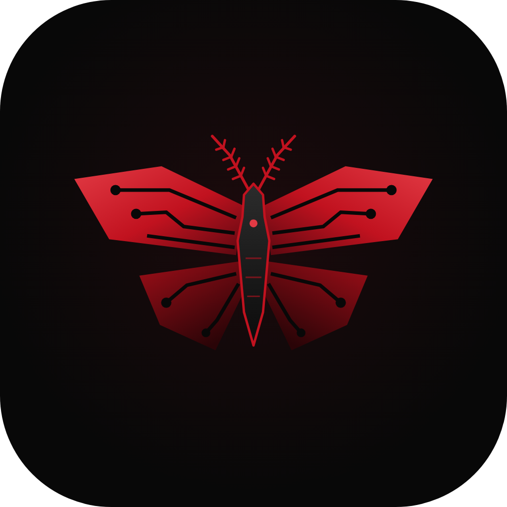

## MOTH Code __VERSION__ for Windows

### What's new in 2.5

- **2.5.2: one chat, like Claude.** The Do-it-on-my-PC tab is gone: ask a question and MOTH answers; tell it to do something and it does it right in the chat, with a live card showing every step, Stop, Keep going and Undo.
- **2.5.1: real numbers.** Home and the Model tab show MOTH's training data (have vs need), a fixed yardstick chart, and live measurements of every computer training it (speed, GPU load, temperature) instead of a guessed "learning stage".
- **Bigger MOTH, no restart from zero.** When MOTH grows (training on this PC or with others), the bigger model starts with the current one's answers and keeps learning, so new versions arrive sooner.

### What's new in 2.4

- **2.4.1: Do it on my PC.** MOTH can work across your whole computer and the web: files anywhere, commands, web pages and its own browser window. It asks before every change, command, new site and anything it types, and never touches passwords or key files. The window is also smaller (1180 × 740).
- **Saved prompts**, **chat tabs**, **Run** on code blocks (temporary folder, 15-second limit, you confirm first) and project files in Ctrl+K.
- Home shows **top helpers this week** and **test scores across versions**.
- **Report a problem** from Settings → Updates & about.
- Network: **Pause while gaming** per computer.

### What's new in 2.3

- **2.3.2:** AI → **Shared training** shows a shared run as an animated picture in plain words. Attach folders, screenshots/photos (or paste them) and GitHub links. Edit or branch from any message, rate any answer, and pick a theme and accent colour.
- **2.3.1:** Home shows this week's progress, how MOTH answers now (before and after its last upgrade) and a one-click **Train on this PC**. Network shows each computer's health and lets you set its training hours. The AI timeline says why each version was or was not promoted.
- **A new, compact look:**
  - The sidebar has New chat, Search chats, **Projects as folders with their chats inside**, then Chats, and your account at the bottom.
  - Your messages sit on the right; MOTH's replies are plain text.
  - One message box with attach, model and Send.
  - A small connection status line.
- **The "This computer" switch tells you when your NVIDIA GPU could train MOTH** through the MOTH Worker instead.

The full list is in [CHANGELOG.md](https://github.com/lk5t/moth-code/blob/__REF__/CHANGELOG.md).

### Install

- **New install, or coming from v0.2.x:** download **`MOTH.Code___VERSION___x64-setup.exe`** below and run it. It
  installs for your user account only; no administrator rights are needed. Your accounts, settings, workspaces,
  training runs, models and checkpoints are kept.
- **Already on v0.3.1 or later:** nothing to do. MOTH Code finds this update by itself, downloads and verifies it in
  the background, and shows *"MOTH Code __VERSION__ is ready — Restart now"*. It also installs when you close the app.

Windows SmartScreen may warn because the installer is not code-signed yet: choose **More info → Run anyway**.

### Connecting

Sign in, and if MOTH Cloud's address needs changing (for example while the permanent domain's HTTPS is being set
up), go to **Settings → Connection**, enter the address, and choose **Test & use**. No reinstall is needed.

| File | What it is |
| --- | --- |
| `MOTH.Code___VERSION___x64-setup.exe` | Windows installer |
| `MOTH.Code___VERSION___x64-setup.exe.sig` | Updater signature (checked by the app before installing an update) |
| `moth-release-desktop-__VERSION__.json` + `.sig` | Signed release manifest |
| `SHA256SUMS` | Checksums |

This is a desktop release. It doesn't change the MOTH Cloud server; server releases are published separately.
