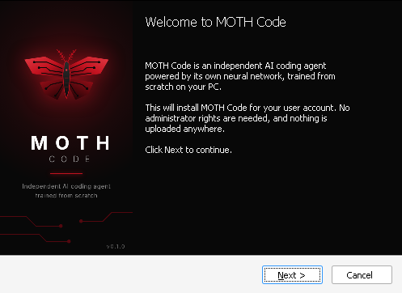
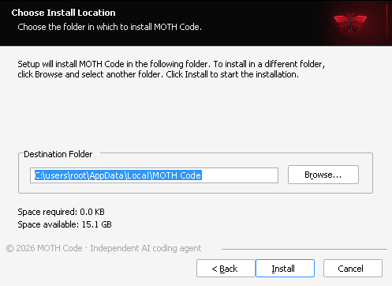
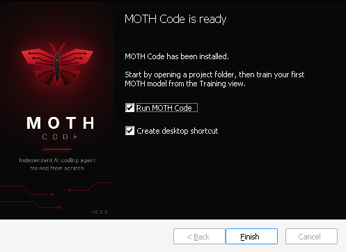

<p align="center">
  
</p>

<h1 align="center">MOTH Code</h1>

<p align="center">An independent Windows desktop AI coding agent powered by its own neural network — MOTH Model — trained from scratch.</p>

---

MOTH Code is a desktop development environment (chat, project explorer, Monaco editor, terminal, Git) whose
intelligence comes **only** from MOTH's own models: original decoder-only Transformers initialised from random weights
and trained by you, on your machine, with data you are licensed to use. No pretrained weights and no third-party AI APIs
are used anywhere.

> **Status: v0.1.0 — Foundation.** The full pipeline works end to end: tokenizer → dataset → training → evaluation
> → export → local inference → chat and autonomous agent. **No trained MOTH model ships with this release.** A small
> model trained for a few minutes produces code-flavoured text, not useful answers, and the agent will report that a task
> is beyond the current model rather than pretend. Capability comes from training MOTH-50M on enough data (see
> [docs/TRAINING.md](docs/TRAINING.md)).

## What's in v0.1

| Area | What works today |
| --- | --- |
| **Desktop app** | Tauri 2 + React/TypeScript, black-and-crimson MOTH design, resizable workspace: chat, collapsible explorer, Monaco editor, integrated terminal, Git changes, activity, memory; training dashboard; models; learning network; settings. |
| **MOTH Model** | Original Transformer (RoPE, RMSNorm, SwiGLU, optional grouped-query attention, KV cache). Presets from `moth-tiny` to `moth-400m`; **MOTH-50M = 49.3M parameters**, 2K context. Custom byte-level BPE tokenizer written from scratch. |
| **Training** | Real forward/backward passes and AdamW updates; CUDA mixed precision with CPU fallback; validation loss; atomic checkpoints with bit-exact resume; pause/resume from the UI; license-tracked datasets; evaluation (loss, perplexity, next-token accuracy, code benchmark); checksummed export. |
| **Owner policy** | Editable conversational content policy (system prompt, generation defaults, block/warn/redact rules). Ships with no topic restrictions. Separate from operational security. |
| **Coding agent** | MOTH-driven plan → tool-call loop over files, search, terminal, Git and memory; permission engine with approvals for destructive/external/out-of-workspace actions; test-based verification; cancel, resume, revert; honest "beyond current model" reporting. |
| **Memory & retrieval** | Per-project memory (architecture, preferences, verified solutions, errors) and an incremental FTS5 code index for large projects. |
| **Learning network** | Strictly opt-in community training protocol: client trains on public shards and uploads only weight deltas; reference coordinator validates (checksums, shapes, update size, probe loss) and aggregates into versioned checkpoints. Personal learning from test-verified tasks, local only. |
| **Hybrid inference** | Local / MOTH Cloud / Automatic. MOTH Cloud protocol, client and a self-hostable reference server; consent required before sending anything remotely, credentials always redacted. **No MOTH-operated servers exist yet**, and the app says so. |
| **Release** | GitHub Actions CI (Windows + Linux), tag-triggered Windows NSIS installer with bundled backend, signed in-app updates from GitHub Releases. |

## Installer

The Windows installer is themed to match the app. Download it from
[Releases](https://github.com/lk5t/moth-code/releases).

<p>
  
  
  
</p>

## Quick start (development)

Prerequisites: Python 3.10+ (3.12 recommended), Node.js 22+, Rust (stable), Git. On Windows also the
[Tauri prerequisites](https://tauri.app/start/prerequisites/) (WebView2 and the MSVC build tools).

```bash
python -m pip install torch --index-url https://download.pytorch.org/whl/cpu
```

For an NVIDIA GPU, install a CUDA build of PyTorch instead (see [docs/SETUP.md](docs/SETUP.md)).

```bash
python -m pip install -e "./backend[dev]"
```

```bash
cd app && npm install && npm run tauri dev
```

`tauri dev` starts the frontend dev server and the desktop shell, which launches the Python backend automatically.

Then, in the app: **Training → Tokenizer → Dataset → Training run → Export**, load the model under **Models**, and chat
or start an agent task in the **Workspace**.

## Repository layout

```
app/                 Desktop app (React + TypeScript + Tailwind + shadcn-style UI)
app/src-tauri/       Tauri 2 shell (Rust): launches and supervises the backend, updater
backend/moth/        Python backend
  model/             MOTH Transformer, BPE tokenizer, generation, export/registry
  training/          data sources & licenses, dataset prep, trainer, checkpoints, evaluation
  agent/             autonomous coding engine, tools, memory, retrieval
  inference/         local inference, MOTH Cloud client/server, hybrid router
  community/         opt-in learning network: protocol, client, coordinator, validation
  policy/            owner-defined content policy
  security/          permissions, approvals, credential detection/redaction
  workspace/         files, project scanner, terminal, git
  server/            FastAPI HTTP/WebSocket API
backend/tests/       pytest suite
branding/            MOTH emblem (SVG) and icon source
docs/                Architecture, setup, training, security, protocols, releasing, limitations, test results
```

## Documentation

- [Architecture](docs/ARCHITECTURE.md)
- [Setup & building](docs/SETUP.md)
- [Training MOTH models](docs/TRAINING.md)
- [Security, permissions & owner policy](docs/SECURITY.md)
- [Community learning & MOTH Cloud protocols](docs/PROTOCOLS.md)
- [Releasing & signed updates](docs/RELEASING.md)
- [Known limitations & unfinished work](docs/LIMITATIONS.md)
- [Verified test results](docs/TEST_RESULTS.md)

## Tests

```bash
cd backend && python -m pytest -q
```

```bash
cd app && npm test && npm run typecheck
```

```bash
cargo test --manifest-path app/src-tauri/Cargo.toml
```

## License

No license has been chosen for this repository yet. Until the owner adds one, default copyright applies.
Training-data licenses are tracked per dataset and recorded in every exported model's manifest.
