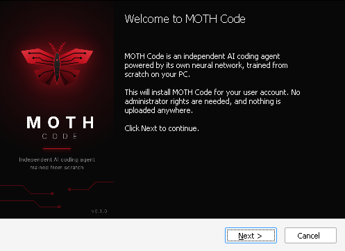
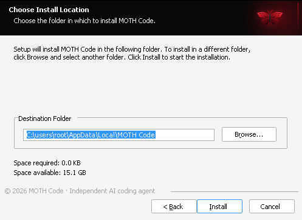
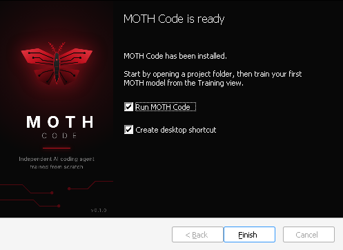

<p align="center">
  
</p>

<h1 align="center">MOTH Code</h1>

<p align="center"><b>An AI coding app with its own AI.</b> MOTH is a language model trained from scratch, by itself, on a
network of computers, and it gets a little smarter every day.</p>

<p align="center">
  <a href="https://github.com/lk5t/moth-code/releases">Download for Windows</a> ·
  <a href="CHANGELOG.md">What's new</a> ·
  <a href="docs/ARCHITECTURE.md">How it works</a>
</p>

---

MOTH Code is a desktop app for writing code with an AI: chat, an agent that edits and runs your project, an editor,
a terminal and Git. The AI behind it is **MOTH**, an original Transformer that started from random weights. **No
pretrained models and no third-party AI services are used anywhere.** Everything MOTH knows, it learned here.

> **Honest status.** MOTH is young. The live model is still small and its answers are simple; it is growing into a
> 7M+ parameter successor right now. You can watch it learn, live, inside the app (Owner) and see each new version
> only replace the old one after it passes every check.

## What's inside

| | |
| --- | --- |
| **Chat** | Conversations with MOTH, with memory of your projects and preferences, long chats compacted automatically, and a usage ring that shows your plan's 5-hour and weekly usage in percent. |
| **Projects** | Explorer, Monaco editor, terminal and Git. **Agent mode** plans a task, writes and runs the code, checks itself and fixes its own mistakes. Every change is a checkpoint you can undo. **Fix this** on any error, live preview for websites, and tests written and run for you. |
| **GitHub** | Connect your account (token kept in the Windows credential vault), clone, pull, push and open pull requests, and invite people to shared projects. |
| **Home** | What MOTH is doing right now, today's progress, recent projects and chats, and a live activity feed. |
| **Network** | Let your computer help train MOTH when it is idle (built in, off until you turn it on), add other computers with one command, and earn usage credits through referrals. |
| **Accounts & plans** | MOTH accounts with two-factor sign-in, Free / Pro / Max plans with monthly, weekly and 5-hour allowances, credits, and a usage page. |
| **Owner only** | The AI section (live training, data, models, evolution), administration, backups, worker actions and every training control. |

## How MOTH learns

MOTH trains itself, continuously, with no one pressing buttons:

1. **Data.** Licensed public datasets (textbooks, Wikipedia, stories, code, maths, conversations) are downloaded,
   cleaned, de-duplicated, filtered by a learned quality model and mixed by a curriculum. MOTH also quizzes itself
   on automatically checked problems and learns from its mistakes.
2. **Training together.** MOTH Cloud and every connected computer (GPUs and CPUs alike) train the same experiment
   in shared rounds and split its steps by speed, so more computers finish sooner. Runs move to shared training
   from their checkpoint as soon as other computers come online.
3. **Growing.** When MOTH outgrows its size, a bigger successor is sized by measured speed and trained, short
   context first, then full length. A successor that is declined keeps its training for the next attempt.
4. **Gates.** A new version replaces the old one only if it is better on held-out data, keeps its other skills,
   stays fast enough and fits in memory. Models with different tokenizers are compared fairly, per byte of text.
5. **Rollout.** Promoted models roll out in stages with monitoring and automatic rollback.

## Install

**Use the app:** download the Windows installer from [Releases](https://github.com/lk5t/moth-code/releases), sign in
and start. Updates install themselves.

**Help train MOTH:** in the app, turn on *Network → Contribute this computer*. For a server or spare PC without the
app, *Network → Add another computer* gives a one-command, checksum-verified install for Windows (PowerShell) and
Linux. NVIDIA GPUs are detected and used automatically. See [docs/WORKER.md](docs/WORKER.md).

**Run MOTH Cloud:** one script installs it on a Linux server, after which it updates itself from signed releases
with backups, health checks and automatic rollback. See [docs/SERVER.md](docs/SERVER.md).

<p>
  
  
  
</p>

## Components

| Component | Path | Runs on |
| --- | --- | --- |
| Desktop app | `app/` (Tauri 2, React, TypeScript) + `backend/` (local tools, agent, training code) | Windows PCs |
| MOTH Cloud | `server/` (accounts, billing, referrals, model registry, serving, Evolution engine, training coordinator) | A Linux server |
| MOTH Worker | `worker/` | Any computer that helps train (Windows or Linux, GPU or CPU) |

```
app/                 Desktop app (React + TypeScript + Tailwind) and the Tauri shell (app/src-tauri)
backend/moth/        Python: model, tokenizer, training, data factory, agent, inference, workspace, policy, security
server/moth_server/  MOTH Cloud: API, billing, evolution (planner, engine, distributed rounds, gates), intelligence
worker/              MOTH Worker: enrollment, jobs, shared rounds, updates, Windows/Linux installers
deploy/              Server installer and the self-updating agent
docs/                Architecture, server, worker, training, security, releasing, limitations
```

## Development

Prerequisites: Python 3.10+ (3.12 recommended), Node.js 22+, Rust (stable), Git; on Windows the
[Tauri prerequisites](https://tauri.app/start/prerequisites/).

```bash
python -m pip install torch --index-url https://download.pytorch.org/whl/cpu
```

```bash
python -m pip install -e "./backend[dev]" -e "./server[dev]" -e "./worker"
```

```bash
cd server && moth-server init-owner && moth-server serve
```

```bash
cd app && npm install && npm run tauri dev
```

Point the app at the development server with `VITE_MOTH_SERVER_URL=http://127.0.0.1:8900` (or Settings → Account).
Development mode writes emails to `data/outbox/`.

## Tests

```bash
cd backend && python -m pytest -q
```

```bash
cd server && python -m pytest -q
```

```bash
cd app && npm test && npm run typecheck
```

```bash
cargo test --manifest-path app/src-tauri/Cargo.toml
```

Every release runs the full suite, real Windows and Linux worker installs, a real install of the signed desktop
installer, and MOTH Cloud's install, update and rollback before anything is published.

## Documentation

[Architecture](docs/ARCHITECTURE.md) · [MOTH Cloud](docs/SERVER.md) · [Workers](docs/WORKER.md) ·
[Training](docs/TRAINING.md) · [Plans & billing](docs/BILLING.md) · [Security](docs/SECURITY.md) ·
[Protocols](docs/PROTOCOLS.md) · [Releasing](docs/RELEASING.md) · [Limitations](docs/LIMITATIONS.md) ·
[Changelog](CHANGELOG.md)

## License

No license has been chosen for this repository yet, so default copyright applies. Training-data licenses are
tracked per dataset and recorded in every model's manifest.
