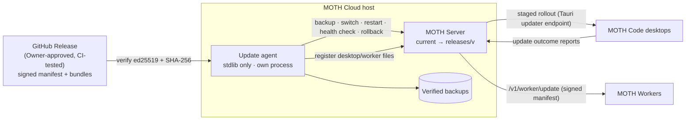
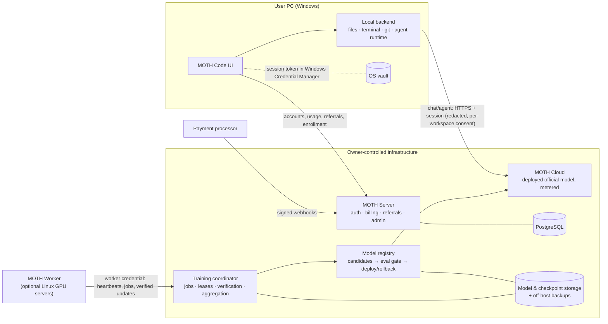
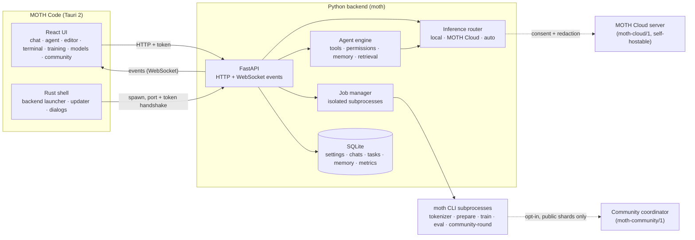

# MOTH Code architecture

## v0.3 additions: self-managing updates



- **One release, one signature.** `scripts/build-release.py` builds `moth-cloud-<v>.tar.gz`,
  `moth-worker-<v>.tar.gz` and `moth-release-<v>.json`. The manifest lists the SHA-256 of every file
  (including the signed desktop installer), the schema and API versions, destructive migrations, the
  minimum upgrade version and the rollout policy, and is signed with ed25519 in CI.
- **Update agent** (`deploy/agent/moth_agent.py`). A separate, standard-library-only process supervised
  by systemd or cron. For each new release it installs into `releases/<v>` (Python environments are
  shared per dependency set in `runtime/`), takes a verified backup, atomically switches `current`,
  restarts the server and verifies health. On any failure it switches back, restoring the database
  backup if the schema changed. It reports every step to `/v1/agent/*` (a private API blocked at the
  proxy) and updates itself last, with crash protection.
- **Compatibility.** Clients send `X-Moth-Client`. `compat.py` refuses versions below the minimum with
  HTTP 426 before any handler runs. Health reports `api_version`, `schema_version` and the minimum
  client versions.
- **Migrations.** `db.MIGRATIONS` are versioned. Additive ones run at startup; destructive ones need
  Owner approval.
- **Model lifecycle.** `models.py` has persistent states. `evalsets.py` selects a compatible evaluation
  dataset per model (text datasets are scored in bits per byte). `moth.model.evaluate` runs in a
  subprocess. Resumable chunked uploads live in `routes/uploads.py`; the desktop side is
  `moth.publish.Publisher`.
- **Desktop.** `lib/endpoint.ts` picks the official endpoint for the environment. `lib/connection.ts`
  monitors and reconnects with backoff. `lib/updater.ts` checks, downloads, installs on restart and
  reports. The session is refreshed daily.

## v0.2 system overview (cloud-only)



- **Cloud-only inference:** the desktop never runs the model for users. Chat and agent steps go to MOTH Cloud,
  where requests are authenticated, policy-checked, metered with reserve-then-settle, and served by the
  deployed official release.
- **One official model:** training contributions produce candidate checkpoints. A candidate reaches users only
  after passing the evaluation gate and being deployed. All users benefit immediately, with no downloads.
- **Isolation:** user sessions, worker credentials and admin capabilities are distinct. Worker credentials cannot
  call user APIs, and admin routes require the Owner role plus recent re-authentication. The desktop app holds no
  backend secrets.
- **Replaceable helpers:** the friend's large-RAM server may run dataset preparation or a coordinator, but
  production auth, billing, inference, model releases and permanent storage live on owner infrastructure.

The v0.1 sections below still describe the desktop shell, the local backend (agent runtime, tools and
permissions) and the MOTH model and training pipeline, which the server and worker reuse.

## v0.1 foundation

## Overview



## Process model

1. **Rust shell** (`app/src-tauri/src/backend.rs`) starts the backend:
   - `MOTH_BACKEND_URL` → connect to an already-running backend (development);
   - `MOTH_PYTHON` → run `python -m moth.server` with that interpreter (e.g. a CUDA environment);
   - bundled `resources/backend/moth-backend(.exe)` (PyInstaller) in installed builds;
   - otherwise the repository's `backend/` with the system Python (development).
   It passes a random per-launch API token, `MOTH_PORT=0` and its own PID. The backend binds an ephemeral
   `127.0.0.1` port and prints `MOTH_BACKEND_READY {"port": N}`. The UI gets `{url, token}` through the
   `backend_info` command. Crashes are detected and surfaced with a Restart button.
2. **Backend** (`python -m moth.server`) serves the API. It exits when the shell dies (parent-PID and orphan
   detection), including when the shell is force-killed.
3. **Long-running work** — tokenizer training, dataset preparation, model training, evaluation, community rounds —
   runs as `moth` CLI subprocesses managed by `moth/jobs.py`. A CUDA error or out-of-memory condition therefore
   cannot take down the backend. Jobs stream JSON events (`@moth {...}` lines) and stop gracefully through a stop
   file (the trainer checkpoints first). In the frozen build the same executable dispatches CLI subcommands.

## Backend modules

| Module | Responsibility |
| --- | --- |
| `server/app.py`, `server/routes_*.py` | API surface. Subsystems register via `server/extensions.py`; one failing to import is reported in `/api/subsystems` instead of crashing the server. |
| `events.py` | Thread-safe pub/sub that feeds the single `/ws/events` WebSocket (topics: `terminal`, `chat`, `task`, `job`, `training`, `files`, `approval`, `model`, …). |
| `db.py` | SQLite with ordered migrations; FTS5 indexes for memory and code chunks. |
| `model/` | `config.py` (presets, analytic parameter count, compatibility key), `transformer.py`, `tokenizer.py` (byte-level BPE), `generation.py` (KV-cache sampling, streaming, cancellation), `chat_format.py`, `registry.py` (export, checksums, loading). |
| `training/` | `sources.py` (license-tracked sources), `data.py` (memory-mapped token bins + loss masks), `trainer.py`, `checkpoint.py`, `evaluate.py`. |
| `agent/` | `engine.py` (loop), `protocol.py` (prompt budget, tool-call parsing), `tools.py`, `manager.py` (persistence, resume, revert), `memory.py`, `retrieval.py`. |
| `inference/` | `local.py`, `cloud.py` + `cloud_server.py` (moth-cloud/1), `router.py` (mode selection, consent, redaction). |
| `community/` | `protocol.py`, `resources.py` (opt-in, limits, schedule), `client.py`, `coordinator.py`, `validation.py`, `aggregation.py`. |
| `policy/engine.py` | Owner-defined conversational policy. |
| `security/` | `permissions.py` (workspace boundary, command classification, approvals), `redaction.py`. |
| `workspace/` | `files.py`, `scanner.py`, `terminal.py`, `git.py`. |

## MOTH Model

Decoder-only Transformer, pre-norm:

```
tokens → embedding → N × [RMSNorm → causal self-attention (RoPE, GQA-capable) → +residual
                          → RMSNorm → SwiGLU MLP → +residual] → RMSNorm → LM head (tied to embedding)
```

| Preset | d_model | layers | heads (kv) | FFN | vocab | context | parameters |
| --- | --- | --- | --- | --- | --- | --- | --- |
| moth-tiny | 64 | 2 | 4 (4) | 192 | 512 | 256 | 0.14M |
| moth-small | 256 | 6 | 4 (4) | 768 | 8,192 | 1,024 | 7.2M |
| **moth-50m** | 512 | 12 | 8 (8) | 1,536 | 16,384 | 2,048 | **49.3M** |
| moth-150m | 768 | 18 | 12 (4) | 2,304 | 32,768 | 4,096 | 149M |
| moth-400m | 1,024 | 30 | 16 (4) | 3,072 | 32,768 | 4,096 | 395M |

The model's vocabulary size is set from the tokenizer, rounded up to a multiple of 64. Weights use a normal(0, 0.02)
initialisation, with residual projections scaled by 1/√(2·layers).

**Tokenizer.** Byte-level BPE (lossless for any input), with code-aware pre-tokenisation (newline + indentation
runs, identifiers, 1–3-digit number groups, punctuation). There are 16 special tokens at ids 0–15. Training uses
incremental pair-count updates. A fingerprint (SHA-256 of the merge table) ties datasets, checkpoints, exported
models and community contributions to one tokenizer.

**Chat / agent format.**
`<|bos|><|system|>…<|end|><|user|>…<|end|><|assistant|>…<|tool_call|>{"tool":…,"args":…}<|end|><|tool_result|>…<|end|>`.
Special tokens are only ever produced from text MOTH Code itself constructs. User text, file contents, tool output
and external datasets are encoded as plain bytes, so they cannot forge control tokens.

## Agent loop

1. Scan the project (languages, build/test commands, entry points), store it as `architecture` memory, update the
   code index, retrieve relevant memories and code chunks.
2. Ask MOTH for a numbered plan (the plan is the model's own; if none is produced, that is recorded).
3. Repeat: build a prompt that fits the context window (dropping retrieved code, then old steps, then memories);
   MOTH emits one tool call; it is validated, permission-checked (approval if required), executed, and its real
   result is appended. A failed command triggers error investigation (related memories) and is remembered.
4. End on `finish`, `give_up`, cancellation, step limit, or three consecutive unusable outputs (`model_incapable`).
5. Verification: if files changed and a test command is known, run it; failures turn the result into `needs_review`.
   The report keeps MOTH's own summary separate from the verified list of changes and commands.

Tasks are persisted after every step. Interrupted tasks become `interrupted` on restart and can be resumed, and
every file change records its previous content so a task can be reverted.

## Data locations

`%APPDATA%\MOTH Code` on Windows (`~/.moth` elsewhere; override with `MOTH_HOME`):

```
moth.db            SQLite database
policy.json        owner content policy
tokenizers/        *.json BPE tokenizers
datasets/<name>/   train.bin val.bin *.mask meta.json
runs/<name>-<id>/  config.json events.jsonl checkpoints/{step_*.pt,best.pt,latest.json}
models/<name>/     model.pt config.json tokenizer.json manifest.json [evaluation.json]
jobs/ community/   job stop files, participation settings
```
